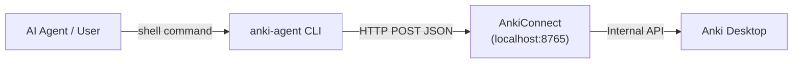

# Kế hoạch: Anki Agent CLI Tools

## Mục tiêu
Xây dựng bộ Python CLI tools giúp AI Agent (hoặc người dùng) quản lý thẻ Anki thông qua **AnkiConnect API** (`http://localhost:8765`). Tools sẽ chạy từ command line, AI agent có thể gọi trực tiếp qua shell.

## Background

### AnkiConnect là gì?
AnkiConnect là add-on Anki Desktop (code: `2055492159`) mở một HTTP server tại `localhost:8765`. Mọi thao tác (thêm/sửa/xóa thẻ, quản lý deck, tags, media...) đều qua HTTP POST với JSON payload:

```json
{
    "action": "deckNames",
    "version": 6,
    "params": {}
}
```

### Kiến trúc tổng quan



> [!IMPORTANT]
> **Yêu cầu tiên quyết**: Anki Desktop phải đang chạy và AnkiConnect add-on phải được cài đặt.

## Hướng dẫn cài AnkiConnect

1. Mở Anki Desktop
2. Vào **Tools → Add-ons → Get Add-ons...**
3. Nhập code: `2055492159`
4. Click OK → Restart Anki
5. Kiểm tra: `curl localhost:8765 -X POST -d '{"action":"version","version":6}'` → `{"result":6,"error":null}`

---

## Proposed Changes

### Cấu trúc Project

```
anki-agent/
├── pyproject.toml              # [NEW] Project config, dependencies
├── README.md                   # [NEW] Hướng dẫn sử dụng
├── src/
│   └── anki_agent/
│       ├── __init__.py         # [NEW] Package init
│       ├── client.py           # [NEW] AnkiConnect HTTP client
│       ├── cli.py              # [NEW] CLI entry point (argparse)
│       ├── commands/
│       │   ├── __init__.py     # [NEW]
│       │   ├── deck.py         # [NEW] Quản lý decks
│       │   ├── note.py         # [NEW] Quản lý notes (thêm/sửa/xóa)
│       │   ├── card.py         # [NEW] Quản lý cards (tìm kiếm, suspend...)
│       │   ├── tag.py          # [NEW] Quản lý tags
│       │   └── media.py        # [NEW] Quản lý media files
│       └── utils.py            # [NEW] Helpers (formatting, output)
├── tests/
│   ├── __init__.py             # [NEW]
│   ├── test_client.py          # [NEW] Unit tests cho client
│   └── test_commands.py        # [NEW] Unit tests cho commands
├── artifacts/                  # Existing
└── GEMINI.md                   # Existing
```

---

### Component 1: AnkiConnect Client (`src/anki_agent/client.py`)

HTTP client wrapper cho AnkiConnect API. Đây là lõi giao tiếp.

```python
"""AnkiConnect HTTP client."""
import json
import urllib.request
from typing import Any

ANKI_CONNECT_URL = "http://localhost:8765"

class AnkiConnectError(Exception):
    """Error from AnkiConnect API."""

class AnkiClient:
    def __init__(self, url: str = ANKI_CONNECT_URL):
        self.url = url

    def invoke(self, action: str, **params: Any) -> Any:
        """Send a request to AnkiConnect and return the result."""
        payload = json.dumps({
            "action": action,
            "version": 6,
            "params": params
        }).encode("utf-8")

        request = urllib.request.Request(self.url, payload)
        with urllib.request.urlopen(request) as response:
            result = json.loads(response.read())

        if result.get("error"):
            raise AnkiConnectError(result["error"])
        return result.get("result")

    def ping(self) -> bool:
        """Check if AnkiConnect is available."""
        try:
            version = self.invoke("version")
            return version is not None
        except Exception:
            return False
```

> [!NOTE]
> Sử dụng `urllib.request` thay vì `requests` để **zero external dependencies** — project chỉ cần Python stdlib.

---

### Component 2: CLI Entry Point (`src/anki_agent/cli.py`)

Sử dụng `argparse` với subcommands:

```
anki-agent deck list
anki-agent deck create "My Deck"
anki-agent note add --deck "Default" --model "Basic" --front "Hello" --back "Xin chào"
anki-agent note find --query "deck:Default"
anki-agent note update --id 1234 --field Front --value "Updated"
anki-agent note delete --ids 1234 5678
anki-agent card find --query "is:due"
anki-agent card suspend --ids 1234
anki-agent tag list
anki-agent tag add --notes 1234 --tags "vocab important"
anki-agent media store --filename "image.png" --path "/path/to/image.png"
```

Output mặc định là **JSON** (dễ cho AI agent parse), có option `--pretty` cho human-readable.

---

### Component 3: Commands

#### [NEW] `src/anki_agent/commands/deck.py` — Quản lý Decks

| CLI Command | AnkiConnect Action | Mô tả |
|---|---|---|
| `deck list` | `deckNamesAndIds` | Liệt kê tất cả decks |
| `deck create <name>` | `createDeck` | Tạo deck mới |
| `deck delete <name>` | `deleteDecks` | Xóa deck |
| `deck stats <name>` | `getDeckStats` | Thống kê deck |

#### [NEW] `src/anki_agent/commands/note.py` — Quản lý Notes

| CLI Command | AnkiConnect Action | Mô tả |
|---|---|---|
| `note add --deck --model --front --back` | `addNote` | Thêm note mới |
| `note add-many --file <json>` | `addNotes` | Thêm nhiều notes từ file JSON |
| `note find --query <query>` | `findNotes` + `notesInfo` | Tìm notes theo query |
| `note info --ids <id...>` | `notesInfo` | Xem chi tiết notes |
| `note update --id --field --value` | `updateNoteFields` | Cập nhật field của note |
| `note delete --ids <id...>` | `deleteNotes` | Xóa notes |
| `note models` | `modelNames` | Liệt kê note types |
| `note model-fields <name>` | `modelFieldNames` | Xem fields của model |

#### [NEW] `src/anki_agent/commands/card.py` — Quản lý Cards

| CLI Command | AnkiConnect Action | Mô tả |
|---|---|---|
| `card find --query <query>` | `findCards` | Tìm cards |
| `card info --ids <id...>` | `cardsInfo` | Xem chi tiết cards |
| `card suspend --ids <id...>` | `suspend` | Tạm ngưng cards |
| `card unsuspend --ids <id...>` | `unsuspend` | Bỏ tạm ngưng |
| `card due` | `findCards` (query: `is:due`) | Xem cards sắp ôn |

#### [NEW] `src/anki_agent/commands/tag.py` — Quản lý Tags

| CLI Command | AnkiConnect Action | Mô tả |
|---|---|---|
| `tag list` | `getTags` | Liệt kê tất cả tags |
| `tag add --notes <ids> --tags <tags>` | `addTags` | Thêm tags vào notes |
| `tag remove --notes <ids> --tags <tags>` | `removeTags` | Xóa tags khỏi notes |

#### [NEW] `src/anki_agent/commands/media.py` — Quản lý Media

| CLI Command | AnkiConnect Action | Mô tả |
|---|---|---|
| `media store --filename --path` | `storeMediaFile` | Upload media file |
| `media retrieve --filename` | `retrieveMediaFile` | Lấy media file |
| `media delete --filename` | `deleteMediaFile` | Xóa media file |

---

### Component 4: Project Configuration

#### [NEW] `pyproject.toml`

```toml
[project]
name = "anki-agent"
version = "0.1.0"
description = "CLI tools for AI Agents to manage Anki flashcards via AnkiConnect"
requires-python = ">=3.10"
dependencies = []  # Zero external dependencies!

[project.scripts]
anki-agent = "anki_agent.cli:main"

[build-system]
requires = ["hatchling"]
build-backend = "hatchling.build"

[tool.pytest.ini_options]
testpaths = ["tests"]
```

> [!TIP]
> Không có external dependencies! Chỉ cần Python stdlib (`urllib.request`, `json`, `argparse`, `base64`).

---

## User Review Required

> [!IMPORTANT]
> **Quyết định thiết kế quan trọng:**
> 1. **Output format**: Mặc định là JSON (AI-friendly). Bạn có muốn thêm option `--format table` cho human-readable không?
> 2. **Safety guards**: Lệnh `delete` sẽ yêu cầu flag `--confirm` hoặc `--force` để tránh xóa nhầm. Đồng ý?
> 3. **Sync command**: Có muốn thêm command `anki-agent sync` để trigger sync với AnkiWeb không?

---

## Open Questions

> [!WARNING]
> - Bạn đang dùng **Anki Desktop** version nào? (AnkiConnect tương thích Anki 2.1.x+)
> - Bạn có muốn tools hỗ trợ **API key** cho AnkiConnect không? (bảo mật thêm khi expose ra ngoài localhost)

---

## Verification Plan

### Automated Tests
```bash
# Chạy unit tests (mock AnkiConnect responses)
python -m pytest tests/ -v

# Type checking (optional)
python -m mypy src/anki_agent/
```

### Manual Verification
1. **Kiểm tra kết nối**: `anki-agent deck list` → hiện danh sách decks
2. **Thêm note**: `anki-agent note add --deck "Default" --model "Basic" --front "test" --back "test"` → trả về note ID
3. **Tìm kiếm**: `anki-agent note find --query "added:1"` → tìm thấy note vừa thêm
4. **Cập nhật**: `anki-agent note update --id <id> --field Front --value "updated"` → thành công
5. **Xóa**: `anki-agent note delete --ids <id> --force` → xóa thành công

### Thứ tự triển khai
1. ✅ `client.py` — AnkiConnect client (core)
2. ✅ `cli.py` — CLI framework
3. ✅ `commands/deck.py` — Deck commands (đơn giản nhất, dùng để test kết nối)
4. ✅ `commands/note.py` — Note commands (quan trọng nhất)
5. ✅ `commands/card.py` — Card commands
6. ✅ `commands/tag.py` — Tag commands
7. ✅ `commands/media.py` — Media commands
8. ✅ Tests + README
